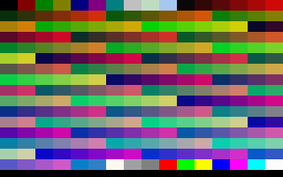
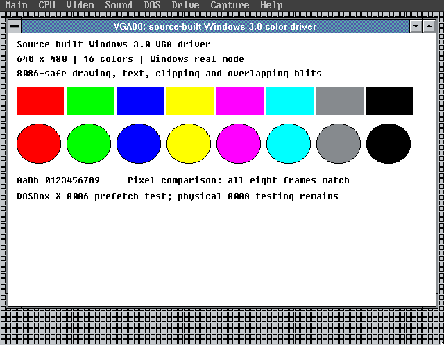
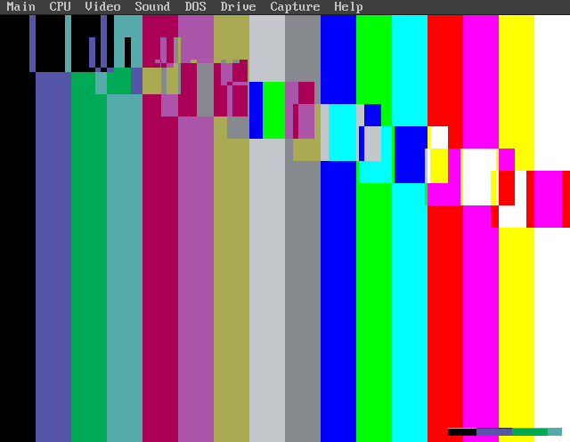

# VGA8088

Source-built Windows 3.0 **real-mode** VGA drivers for 8086/8088-class CPUs: **640 × 480, 16 colors** or **320 × 200, 256 colors**.

## A very serious institution

**The Chad Doebelin Center for Video Card Drivers Who Can’t Do 16-Bit Data Buses Good and Wanna Fetch Instructions Good Too.**

The driver has to be at least… three bytes smaller than this!

## Choose a mode

- **640 × 480, 16 colors:** [dist/VGA88.DRV](dist/VGA88.DRV), the original higher-resolution driver. Its source and build command below are unchanged.
- **320 × 200, 256 colors:** [dist/VGA256.DRV](dist/VGA256.DRV), the new standard-VGA mode 13h driver. Its source is in [vga256](vga256). No Video Seven or SVGA extensions are required.

Exit Windows completely, copy the chosen driver into the Windows SYSTEM directory, and set `display.drv=VGA88.DRV` or `display.drv=VGA256.DRV` under `[boot]` in SYSTEM.INI. Keep the existing VGA system fonts installed and start `WIN /R`.

The 256-color mode provides more colors at a smaller desktop resolution. Some application windows will not fit at 320 × 200. It does not add higher-resolution SVGA modes.

### Build the 256-color driver

Use the same toolchain and DOSBox-X requirements listed below:

```sh
python vga256/tools/build.py \
  --toolchain /path/to/historical-toolchain \
  --dosbox /path/to/dosbox-x \
  --lease /path/to/existing-shared-emulator.lock \
  --out /path/to/new-build-directory
```

The output is `VGA256.DRV`. Normal source edits do not require updating hashes or manifests.

### 256-color capture



Intentional 16 × 16 palette test grid, drawn through Windows 3.0 GDI. This image is rendered from the actual captured VGA framebuffer and DAC palette, not a photographed or SDL-window screenshot.

The 256-color driver passed the same Win16 test on DOSBox-X's 386 and `8086_prefetch` models: 256 distinct pixel indices with matching palette colors, all 20 ordinary RGB system colors, 272 monochrome conversion cases, screen/memory copies, overlapping blits in all four directions, and visible text. The captured frames and palettes matched across both models. **Physical 8088 hardware testing remains pending.** Full-screen DOS task switching and grabber behavior have not been validated.

## Why this exists

Windows 3.0 can run in real mode on an 8088, but its VGA display-driver sources contain later-CPU instructions. Fixing visible instructions alone is insufficient: the BitBlt compiler also emits immediate-count rotates at runtime. The original 8088 additionally needs care when interrupts restart repeated string instructions with more than one prefix.

This project fixes and assembles the source, including the runtime code generator. It uses the retail Windows 3.0 DDK and matching Windows 3.0 SDK macros. The genuine VGA backend is retained: BIOS mode 12h, VGA DAC programming, 480-line cursor limits, 96-DPI metrics, VGA state/save-bitmap modules and RC-HIGH resources. This is not the EGA 640×350 build renamed as VGA.

The protected-mode-only 386 text renderer is omitted, and protected-mode physical enablement is explicitly rejected. **Use Windows real mode (`WIN /R`).**



The screenshot is the actual emulated Windows display surface.

## 640 × 480 driver status

The candidate is 58,128 bytes, SHA-256:

`d4ca7b06604a1bb106cf63ea44333e9ae375696ada8d6ed1a559211d5326accc`

- All 39 linked object modules are rebuilt from source. The clean portable build reproduces the exact candidate binary.
- Static instruction audit covers 14,814 emitted rows, with no unsupported encoding.
- OMF/MAP closure accounts for every linked CODE/DATA contribution, including alignment. Import libraries add no executable or data bytes.
- All ten overridden REP-copy sites use 8088-safe loops. Forty-four ordinary single-prefix REP instructions remain; no multi-prefix REP is emitted.
- Seventy-four matching high-resolution resource records are rebuilt and roundtrip-checked.
- Windows 3.0 real-mode GUI tests complete with zero reported failures on DOSBox-X's `8086_prefetch` and 386 models. All eight complete four-plane captures match one another and the stock VGA driver on the 386 model, byte for byte.

**Emulator-tested, not physical-8088 hardware-qualified.** DOSBox-X's experimental 8086-prefetch model is not a true or cycle-accurate 8088. Physical interrupt restart behavior, boards/BIOS variants, timing and broader application coverage remain to be tested.

## Build the 640 × 480 driver

The source, resources, build/audit tools and [candidate binary](dist/VGA88.DRV) are supplied. Historical compiler executables and Windows installation files are not included.

Requirements:

- Python 3 and an existing DOSBox-X installation.
- MASM 5.10 (`MASM.EXE`).
- Microsoft Segmented-Executable Linker 5.01.17 (`LINK4.EXE`).
- `EXE2BIN.EXE` and Windows 3.0 DDK `SWINLIBC.LIB`.
- The same existing, nonempty emulator lease used by other emulator work on your machine. The script never creates/replaces it and refuses to run beside another live emulator.

The script finds the required toolchain files by name under the supplied directory and builds a fresh output tree. Compatible tools and source edits are supported without fixed checksum requirements. Compiler, linker and resource-packing errors stop the build.

```sh
python tools/build.py \
  --toolchain /path/to/historical-toolchain \
  --dosbox /path/to/dosbox-x \
  --lease /path/to/existing-shared-emulator.lock \
  --out /path/to/new-build-directory
```

The new directory contains `VGA88.DRV`, `VGA.RES`, full MASM listings, linker MAP and compiler logs. The compiler runs on an emulated 386 for speed; `.8086` guards constrain the emitted driver instructions. Runtime-generated instructions are handled separately by the source changes and validation.

`BUILD.BAT` also supports a period DOS setup with the prepared tree on drive R:, containing SRC, INC, RES, BIN and LIB. The Python script prepares that tree and packs the resources afterward. Existing audit scripts remain available separately under `tools/`.

## Try the 640 × 480 driver

Use a disposable Windows 3.0 installation configured for standard VGA 640×480, 16 colors, with matching VGASYS.FON, VGAFIX.FON and VGAOEM.FON. Exit Windows completely, place VGA88.DRV in the SYSTEM directory, set `display.drv=VGA88.DRV` under `[boot]` in SYSTEM.INI and start `WIN /R`. This driver intentionally refuses protected-mode Windows.

## Validation and details



Intentional GDI test pattern: color bars and overlapping XOR rectangles exercise screen-to-memory-to-screen blits. This is expected test output, not display corruption.

- [GUI source](tests/EGAQA.C)

Inspired by Tony814's VGAon8088 work.

## The Center

> Chad Doebelin's Video Card Drivers For Computers Who Can't Do 8-bit external data buses and want to Queue better too?

**The Chad Doebelin Center for Video Card Drivers Who Can’t Do 16-Bit Data Buses Good and Wanna Fetch Instructions Good Too.**

The driver has to be at least… three bytes smaller than this!
